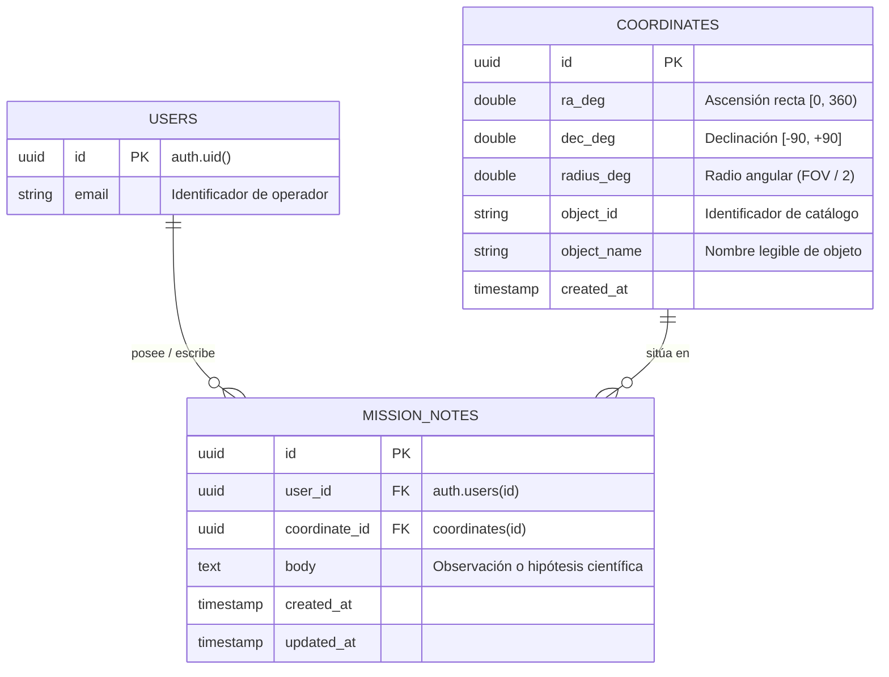

# Arquitectura de Base de Datos y Bitácora de Misión (Mission Notes)

Este documento detalla el modelado de datos, la relación ternaria y la arquitectura de autenticación y persistencia para **AetherScope**, implementada sobre **PostgreSQL / Supabase** con soporte para desarrollo desacoplado en modo local (`localStorage`).

---

## 1. Modelo Entidad-Relación y Relación Ternaria

El sistema modela la interacción entre **Usuarios**, **Coordenadas Celestes** y **Notas de Misión**:



### Reglas de Negocio Formalizadas
1. **Unicidad de pertenencia de la nota:** Cada nota pertenece exactamente a **un único usuario** y a **un único par de coordenadas**.
2. **Multiplicidad de coordenadas:** Un par de coordenadas puede tener **múltiples notas** asociadas (tanto de distintos usuarios como del mismo usuario a lo largo de sucesivas observaciones).
3. **Aislamiento por usuario:** Un usuario conoce **únicamente sus propias notas**. Al consultar un par de coordenadas donde otros observadores han dejado notas, el usuario únicamente visualiza las suyas propias.
4. **Relación ternaria reificada:** La tabla `mission_notes` actúa como la entidad asociativa que consolida la relación ternaria entre el Operador (`user_id`), el Sector Espacial (`coordinate_id`) y el Registro Científico (`body`).

---

## 2. Esquema Físico de Base de Datos (PostgreSQL)

### Tabla `public.coordinates`
Almacena ubicaciones y objetos astronómicos únicos observados para evitar redundancia espacial:
```sql
create table public.coordinates (
  id uuid primary key default gen_random_uuid(),
  ra_deg double precision not null check (ra_deg >= 0 and ra_deg < 360),
  dec_deg double precision not null check (dec_deg >= -90 and dec_deg <= 90),
  radius_deg double precision not null default 0.1 check (radius_deg > 0),
  object_id text,
  object_name text,
  created_at timestamptz not null default now(),
  constraint uq_coordinates_position unique (ra_deg, dec_deg)
);
```

### Tabla `public.mission_notes`
Registros científicos vinculados ternariamente con claves foráneas:
```sql
create table public.mission_notes (
  id uuid primary key default gen_random_uuid(),
  user_id uuid not null default auth.uid() references auth.users (id) on delete cascade,
  coordinate_id uuid not null references public.coordinates (id) on delete cascade,
  body text not null check (char_length(body) <= 10000),
  created_at timestamptz not null default now(),
  updated_at timestamptz not null default now()
);
```

### Índices de Rendimiento
- `idx_coordinates_position`: Búsqueda directa por `(ra_deg, dec_deg)`.
- `idx_mission_notes_user_id`: Filtrado rápido de notas por usuario autenticado.
- `idx_mission_notes_coordinate_id`: Recuperación de notas por sector o coordenada.
- `idx_mission_notes_user_coordinate`: Consulta optimizada para la intersección de notas de un usuario en un sector específico.

### Seguridad a Nivel de Filas (Row Level Security - RLS)
Para cumplir con la regla de que ningún usuario acceda a notas ajenas, PostgreSQL fuerza RLS a nivel de motor:

```sql
alter table public.mission_notes enable row level security;

-- Solo el dueño de la nota puede seleccionarla (SELECT)
create policy "Users can read only their own notes"
  on public.mission_notes for select
  to authenticated
  using ((select auth.uid()) = user_id);

-- Solo el usuario autenticado puede insertar sus notas (INSERT)
create policy "Users can insert only their own notes"
  on public.mission_notes for insert
  to authenticated
  with check ((select auth.uid()) = user_id);

-- Solo el usuario puede actualizar o borrar sus notas (UPDATE / DELETE)
create policy "Users can update only their own notes"
  on public.mission_notes for update
  to authenticated
  using ((select auth.uid()) = user_id)
  with check ((select auth.uid()) = user_id);

create policy "Users can delete only their own notes"
  on public.mission_notes for delete
  to authenticated
  using ((select auth.uid()) = user_id);
```

---

## 3. Integración en el Frontend (Next.js 16)

1. **Autenticación (`lib/auth/`):**
   - `SupabaseAuthService`: Gestiona login (`signIn`), registro (`signUp`), logout (`signOut`) y estado persistente con `onAuthStateChange`.
   - `AuthProvider`: Contexto React global disponible en toda la aplicación.
   - `AuthModal`: Modal táctico con estética retro-futurista accesible desde el botón "ACCESO / OPERADOR" del `HeaderBar`.

2. **Repositorio de Notas (`lib/notes/`):**
   - `SupabaseNotesRepository`:
     - Inserta/resuelve coordenadas celestes atómicamente.
     - Persiste notas vinculadas con el `auth.uid()` del operador.
     - Aplica el filtro espacial y garantiza que sólo se reciban notas del usuario autenticado.
   - `LocalNotesRepository`: Mantiene fallback completo offline/localStorage si `NEXT_PUBLIC_NOTES_BACKEND=local`.

---

## 4. Guía de Puesta en Marcha en Supabase

1. **Configurar Variables de Entorno (`.env.local`):**
   ```env
   NEXT_PUBLIC_NOTES_BACKEND=supabase
   NEXT_PUBLIC_SUPABASE_URL=https://<tu-id-proyecto>.supabase.co
   NEXT_PUBLIC_SUPABASE_PUBLISHABLE_KEY=<tu-anon-key>
   ```

2. **Aplicar la Migración en Supabase SQL Editor:**
   Copiar y ejecutar el contenido de [20260101000000_create_mission_notes.sql](file:///d:/Facultad/AetherScope/supabase/migrations/20260101000000_create_mission_notes.sql).

3. **Instalación de Dependencias:**
   ```powershell
   npm install
   ```
